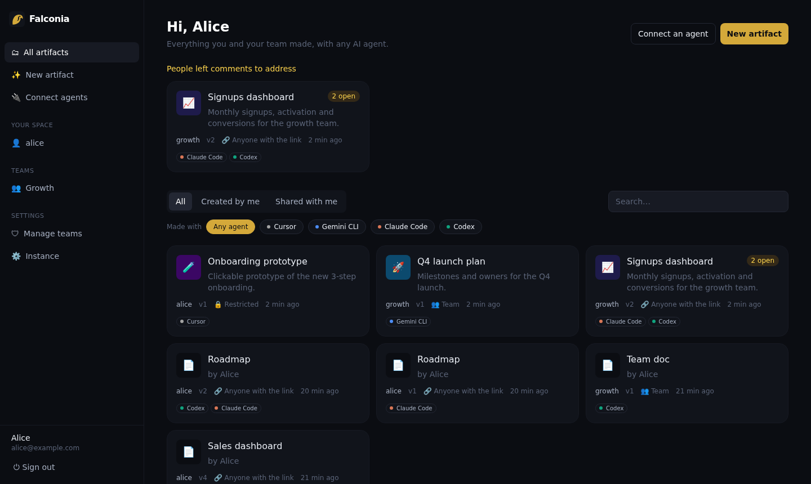
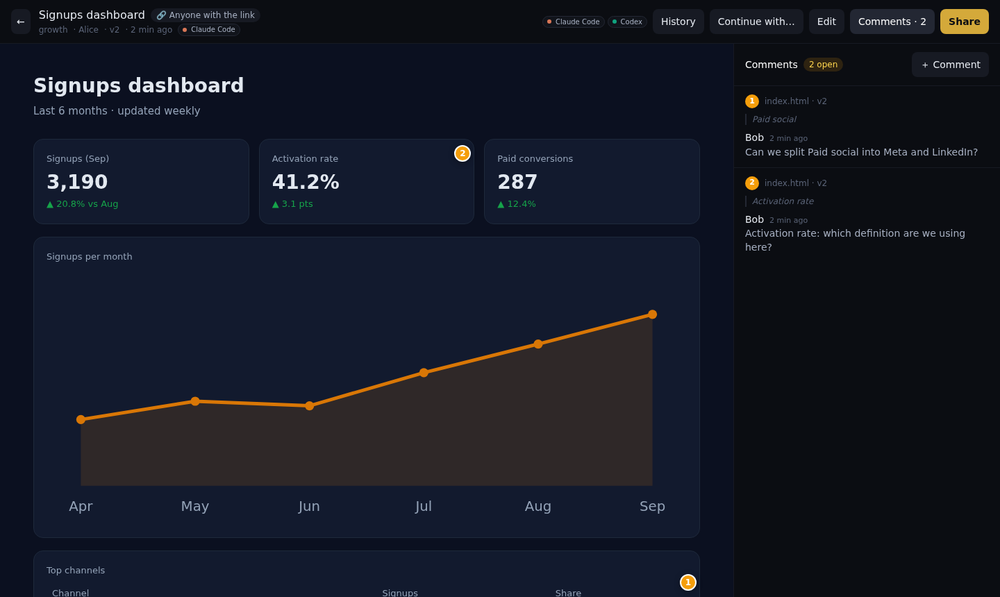
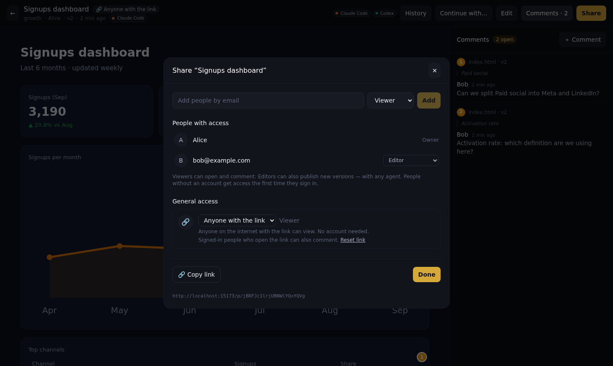
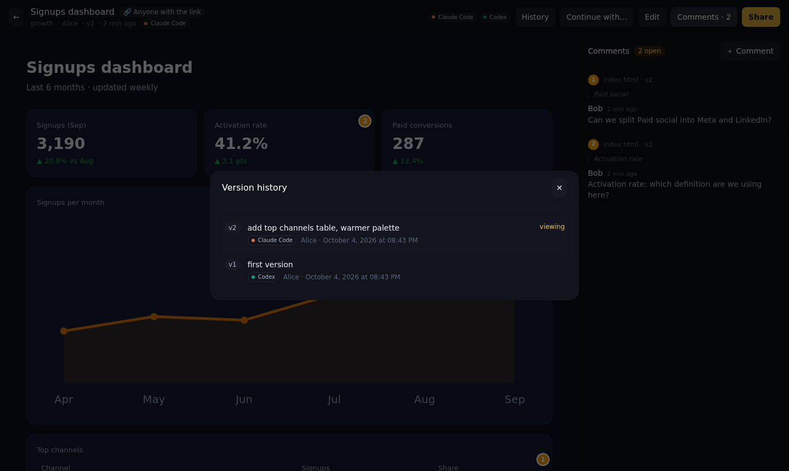
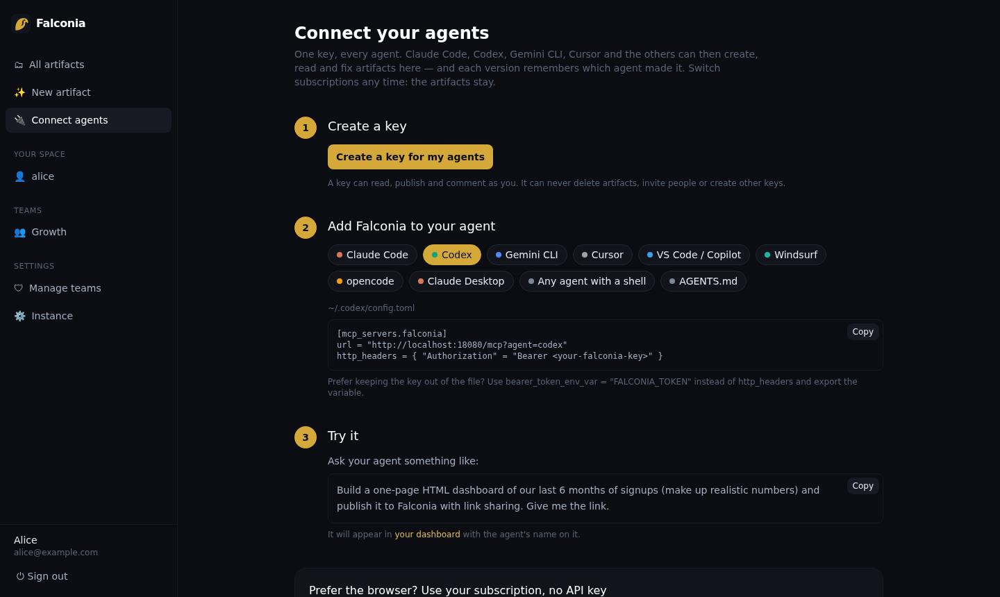

<p align="center">
  
</p>

<h1 align="center">Falconia</h1>

<p align="center">
  <strong>Artifacts from every AI agent, in one place your team owns.</strong><br>
  Make it with Claude, fix it with Codex, let a teammate improve it with Gemini.<br>
  Share it with a link. Keep every version. Never lose it when you switch subscriptions.
</p>

<p align="center">
  <a href="LICENSE"></a>
  <a href="https://github.com/clackes/falconia/actions/workflows/ci.yml"></a>
  
  
</p>

<p align="center">
  
</p>

---

## Why

AI agents are great at making *things*: dashboards, reports, prototypes, little
tools. But where those things live depends on which AI you pay for. A Claude
artifact lives in Claude. If you switch to Codex next month, or your teammate
uses Gemini, the artifact stays behind, and with it the version history and the
feedback around it.

Falconia is the neutral ground. It is a self-hosted dashboard where a group of
people publish, share and iterate on artifacts made by **any** agent:

- **Every agent, one home.** Claude Code, Codex, Gemini CLI, Cursor, VS Code,
  Windsurf, opencode, Claude Desktop, or anything with a shell. Connect them over
  MCP or the CLI with one key.
- **No lock-in.** Any agent can pick up any artifact: read its source, change it,
  publish the next version at the same URL. `falconia pull` hands the files to
  whichever agent you use today; the zip download hands them to you.
- **Share like a Google Doc.** Restricted, your team, or *anyone with the link*,
  with no account needed to view. Add people by email as viewers or editors.
- **Feedback on the page.** People pin comments to the exact spot that needs
  fixing. Agents read them (`list_threads`, `falconia comments`), fix the page,
  and resolve the threads.
- **Provenance.** Every version and comment records which agent made it, so you
  can watch an artifact pass from Claude to Codex to Gemini.
- **Safe by construction.** Artifacts are untrusted code: they run on a separate
  origin inside a sandboxed iframe, never next to your session.

> *Falconia* is the city in *Berserk* where every kind of being lives side by
> side. Here, it's every AI agent.

## See it

| A shared artifact, with comments pinned on the page | Share it like a Google Doc |
| --- | --- |
|  |  |
| **Every version remembers which agent made it** | **One key, a config for every agent** |
|  |  |

## Quick start

```bash
git clone https://github.com/clackes/falconia && cd falconia
cp .env.example .env
docker compose up --build -d
```

Open <http://localhost:5173> and sign up. The first account becomes the instance
administrator.

| | |
| --- | --- |
| Web interface | <http://localhost:5173> |
| API, MCP endpoint, CLI installer | <http://localhost:8080> |
| Artifact content (separate origin) | <http://localhost:8081> |

Ports taken? Change `APP_PORT`, `API_PORT`, `CONTENT_PORT` in `.env` along with
the matching URLs. For a real deployment with your own domains, see
[docs/deploy.md](docs/deploy.md).

## Connect your agents

Open **Connect agents** in the interface: it creates a key and gives you a
ready-to-paste config for each agent. For example:

```bash
# Claude Code
claude mcp add --transport http --scope user falconia \
  "http://localhost:8080/mcp?agent=claude-code" --header "Authorization: Bearer $FALCONIA_TOKEN"

# Gemini CLI
gemini mcp add --scope user --transport http falconia \
  "http://localhost:8080/mcp?agent=gemini-cli" --header "Authorization: Bearer $FALCONIA_TOKEN"
```

```toml
# Codex — ~/.codex/config.toml
[mcp_servers.falconia]
url = "http://localhost:8080/mcp?agent=codex"
bearer_token_env_var = "FALCONIA_TOKEN"
```

Cursor, VS Code, Windsurf, opencode, Claude Desktop and the rest are covered in
[docs/agents.md](docs/agents.md). Then just ask:

> Build a one-page dashboard of our last 6 months of signups and publish it to
> Falconia with link sharing.

### Or use the CLI, from any agent with a shell

```bash
curl -fsSL http://localhost:8080/api/install | sh     # Windows: irm …/api/install.ps1 | iex
falconia login

falconia deploy ./dist --title "Q3 report" --visibility link -m "first draft"
falconia pull growth/q3-report          # continue someone else's artifact
falconia comments growth/q3-report      # what people asked for
falconia resolve <thread-id>
```

The CLI recognizes Claude Code, Codex and Gemini CLI from their environment and
labels what they publish. Drop the snippet from
[docs/agents.md](docs/agents.md#project-instructions) into your project's
`AGENTS.md` and every agent in the repo knows the workflow.

### Or drive your own agent from the browser, on your subscription

`falconia agent` connects the Claude Code, Codex or Gemini CLI on your computer
to the web interface. You chat in the browser, your agent does the work on your
machine with your subscription, and model credentials never pass through the
server. See [docs/local-agent.md](docs/local-agent.md). The built-in chat also
works with your own key for Anthropic, OpenAI, Gemini, OpenRouter, or a local
model (Ollama, LM Studio).

## Sharing

General access works like a Google Doc's:

| General access | Who can open |
| --- | --- |
| **Restricted** | you and the people you add by email |
| **Team** | everyone in the team that owns the space, as viewers or editors |
| **Anyone with the link** | anyone with the secret `/p/…` link, without an account |

People added by email can be **viewers** (open and comment) or **editors** (also
publish new versions, with any agent). Invitations work before someone has an
account. Links can be reset at any time, and switching back to Restricted closes
the door instantly.

## The review loop

1. An agent publishes. The address `/s/<space>/<slug>` never changes again.
2. Someone opens it, clicks a spot on the page and writes a comment. They need
   no access to the code, and no idea what an artifact is.
3. Any agent reads the open comments, with the file, the CSS selector and the
   quoted text of each one.
4. It fixes the page, publishes to the same address, and resolves the threads.

A comment stays attached to its spot even when the page is regenerated from
scratch by a different agent: its anchor keeps three clues (selector, quoted
text, relative position) and tries them in order. When none holds, the thread
becomes "detached" but stays visible.

## Writing artifacts

A complete, self-contained HTML document, or a folder with `index.html` at the
root. Markdown works too. No network requests: inline everything. To keep data
in the viewer's browser there is a small injected SDK:

```html
<script>
  Falconia.setSchemaVersion(2)
  Falconia.registerMigration(1, (old) => ({ ...old, read: false }))
  Falconia.onReady(({ state, save }) => {
    const data = state ?? { items: [] }
    // …draw the interface, then save(data) on changes
  })
</script>
```

## Security model

An artifact is code written by a model and read by nobody. Falconia is built
from that premise:

- **Two origins.** The app and the artifacts live on different hosts; the
  backend refuses to start if they match. Artifact code can't read the viewer's
  token or call the API on their behalf, even if the sandbox were removed.
- **Opaque-origin iframe.** `sandbox="allow-scripts"` without
  `allow-same-origin`: no cookies, no `window.parent`. The only channel is a
  `MessageChannel` handed over after load.
- **Authorization in the path.** Content is reached through a signed URL that
  lasts two hours, so it works without third-party cookies.
- **Keys are weaker than accounts.** An API key can't delete artifacts, manage
  teams or issue keys, which makes it bearable to put one in an agent's config.
- **Provider keys are never stored.** The built-in chat forwards your key per
  request, and the local agent bridge never sees one at all.

Report vulnerabilities privately: see [SECURITY.md](SECURITY.md).

## Architecture

```
backend/            Go: API, MCP server, content server, embedded migrations
cli/                the falconia CLI (Go, standard library only)
frontend/           React, Vite, Tailwind
docs/               self-hosting, agents, local agent bridge, CI, API reference
skill/              a skill that teaches agents to use Falconia well
tests/e2e/          end-to-end smoke test
```

PostgreSQL holds metadata; file bytes are content-addressed blobs on disk or in
any S3-compatible bucket. Redeploying a 50 MB bundle with one changed line
uploads a few kilobytes.

## Documentation

- [Connecting agents](docs/agents.md): MCP configs for every client, the MCP tools, the CLI
- [Your subscription, no API key](docs/local-agent.md): the `falconia agent` bridge
- [Self-hosting](docs/deploy.md): two hostnames, reverse proxy, backups, upgrading
- [Publishing from CI](docs/ci.md): previews for every pull request
- [API reference](docs/api.md)

## Contributing

Issues and pull requests are welcome. Start with [CONTRIBUTING.md](CONTRIBUTING.md).
Coding agents working on this repository should read [AGENTS.md](AGENTS.md).

The review loop owes a debt to [Glance](https://github.com/plivo-labs/glance) by
Plivo Labs and to [display.dev](https://display.dev).

## License

[Apache License 2.0](LICENSE). Use it, self-host it, build on it.
